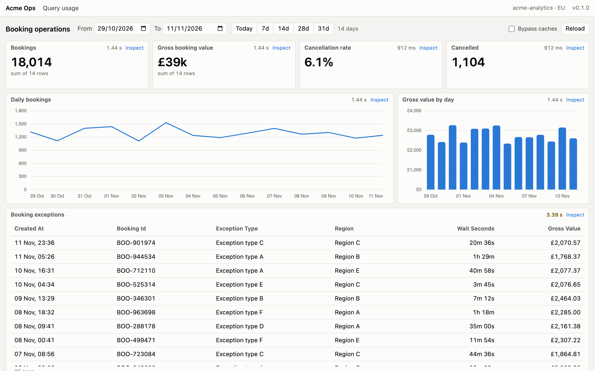

<div align="center">

# bqdash

**BigQuery dashboards as code. You can see what every tile costs.**

Write SQL and a few lines of YAML, commit them to Git, and run the dashboard locally with one
command. Every tile links to the BigQuery job that ran it, with its timing, bytes billed and
SQL version.

[](https://www.python.org/downloads/)
[](https://cloud.google.com/bigquery)
[](#built-for-coding-agents)

</div>

```sh
bqdash init my-ops && cd my-ops && bqdash up --fixture
```



*Illustrative data from the test project, shown in live mode against a simulated warehouse.
The exceptions tile is highlighted because it took over 3 seconds to load.*

## What you get

- **Dashboards in Git:** each dashboard is one YAML file. Each query is a `.sql` file plus a
  `.yaml` file that declares its typed params and output columns. Review changes in pull
  requests, like any other code.
- **One command to launch:** `bqdash up` checks the project, your credentials and the engine
  version, then serves the dashboard on 127.0.0.1 and opens the browser.
- **Dense by default:** compact filter bar, 30 px table rows, sticky headers,
  right-aligned numbers, and explicit money, percent and duration formats. You choose what
  goes on the page; bqdash decides how it looks.
- **Cost on every tile:** **Inspect** opens the BigQuery job behind a tile: queue and
  execution time, bytes billed, slots, cache hit, the exact SQL version and a console link.
- **One job per query:** tiles that share a query share one job, and identical concurrent
  requests share one in-flight job. A warm reload submits nothing.
- **Guard rails:** typed and validated params, a single read-only `SELECT` per query,
  `maximum_bytes_billed` on every job, a row cap and a concurrency limit.
- **Before/after measurements:** `bqdash bench` runs a query with both caches bypassed, and
  the usage screen compares SQL versions on the same dates.
- **Ready for coding agents:** every project ships with rules, three skills for Codex and
  Claude Code, and free discovery commands with JSON output.

bqdash is BigQuery-only and runs locally as a single process. A hosted mode is planned but
not built.

## Quickstart

### 1. Install the prerequisites

You need [uv](https://docs.astral.sh/uv/getting-started/installation/), the
[gcloud CLI](https://cloud.google.com/sdk/docs/install), and a Google Cloud project with
BigQuery enabled to bill queries to. On macOS with Homebrew:

```sh
brew install uv
brew install --cask google-cloud-sdk
```

### 2. Install bqdash

```sh
uv tool install 'git+ssh://git@github.com/lucasscariot/bqdash.git@main'
uv tool update-shell
bqdash --version
```

The repository is private, so the install uses your GitHub SSH key. The built UI ships inside
the package, so you don't need Node.

### 3. Create a project and look at it

```sh
bqdash init my-ops --billing-project my-gcp-project --location EU
cd my-ops
bqdash up --fixture
```

`--fixture` renders the example dashboard with representative data, with no BigQuery
account involved. Edit `dashboards/overview.yaml` and reload the page to see the change.

### 4. Connect BigQuery

```sh
gcloud auth application-default login
bqdash dry-run orders_daily      # free: bytes estimate, tables read
bqdash up
```

First point `queries/orders_daily.sql` at one of your tables. Queries run with your
Application Default Credentials, so your BigQuery permissions decide what dashboards can read.

## A dashboard in two files

```yaml
# queries/bookings_daily.yaml
title: Daily bookings
params: {start_date: DATE, end_date: DATE}
columns: {day: DATE, bookings: INT64, gross_value: NUMERIC}
formats: {gross_value: money}
```

```sql
-- queries/bookings_daily.sql   (end_date is exclusive)
SELECT DATE(created_at) AS day, COUNT(*) AS bookings, SUM(gross_value) AS gross_value
FROM `analytics.fct_bookings`
WHERE DATE(created_at) >= @start_date AND DATE(created_at) < @end_date
GROUP BY day ORDER BY day
```

```yaml
# dashboards/booking_ops.yaml
title: Booking operations
date_range: {default_days: 7, max_days: 31}
tiles:
  - {type: kpi,   query: bookings_daily, value: bookings, reduce: sum, span: 3}
  - {type: line,  query: bookings_daily, x: day, y: bookings, span: 9}
  - {type: table, query: booking_exceptions, span: 12}
```

The KPI and the trend share one BigQuery job. Tile types are `kpi`, `line`, `bar`, `table`
and markdown `text`. `bqdash guide dashboards` has the full reference.

## Everyday use

| Want to… | Run |
| --- | --- |
| Launch the project | `bqdash up` |
| Launch without BigQuery | `bqdash up --fixture` |
| Validate queries and dashboards | `bqdash check` |
| See what a query would scan (free) | `bqdash dry-run <query>` |
| Find tables and columns (free) | `bqdash tables`, `bqdash schema <table>` |
| See what each query costs (free) | `bqdash usage`, or **Query usage** in the app |
| Print a query's rows (billed) | `bqdash run <query> --start 2026-11-01 --end 2026-11-08` |
| Measure a change, caches bypassed (billed) | `bqdash bench <query> --start … --end …` |
| Screenshot a dashboard | `bqdash preview <dashboard> --fixture --screenshot out.png` |
| Read the reference for your version | `bqdash guide [queries\|dashboards\|config\|cli]` |
| Refresh agent files after an upgrade | `bqdash agents sync` |

`--start` is inclusive and `--end` is exclusive. Most commands accept `--json`.

## Know what every tile costs

<table>
<tr>
<td width="45%"></td>
<td>

**Inspect** on any tile opens the run behind it:
- the filters used, and whether the result came from a new job, a shared job or the app cache
- the BigQuery job, with a console link
- a queue, execution and transfer timing bar
- bytes processed and billed, slots, the BigQuery cache result and the estimated cost
- the SQL hash and project commit, so you can tell exactly which SQL produced the numbers

**Query usage** groups history by saved query:
- requests vs. jobs, and app and BigQuery cache hit rates
- p95 response and p95 BigQuery execution time
- bytes billed with an estimated on-demand cost, or slot-hours on reservations

Each query drills down to its individual runs and to a **SQL versions** table that compares
median execution time, bytes billed and slot-ms between versions.

</td>
</tr>
</table>


### How a dataset is served

1. **Validate.** The browser sends a query ID and filter values. The server checks that the
   query is on that dashboard, validates types and the date range, and binds native
   BigQuery parameters.
2. **Reuse.** The cache key is query ID + SQL hash + normalized params (default TTL 120 s).
   Concurrent requests for the same key share one in-flight job.
3. **Limit.** At most 4 jobs run at once, results are capped at 2,000 rows, and every job
   carries `maximum_bytes_billed`.
4. **Trace.**
   - Each job's ID is generated by bqdash and saved before submission.
   - If a submit times out, bqdash looks up that same ID before retrying.
   - If the dashboard stops waiting, a background reconciler still records the final job stats.

History lives in `.bqdash/history.sqlite3`, behind a storage interface. App cache hits reuse
the original job, so spend is never counted twice.

## Built for coding agents

Every project `bqdash init` creates includes:

| File | For |
| --- | --- |
| `AGENTS.md` | Rules: which commands are free and which are billed, SQL conventions, what "done" means. Codex reads it. |
| `CLAUDE.md` | Imports `AGENTS.md` for Claude Code. |
| `.agents/skills/`, `.claude/skills/` | `build-dashboard`, `optimize-query` and `rebuild-dashboard`, for Codex and Claude Code. |
| `CONTEXT.md` | **Yours:** trusted tables, metric definitions, conventions. Agents read it first. |

```text
> build a dashboard of cancellations by region for the last 30 days
```

`build-dashboard` takes the agent through these steps:
1. Find tables (`bqdash tables`, `bqdash schema`).
2. Write the SQL and YAML.
3. Check the cost (`bqdash dry-run`) and validate (`bqdash check`).
4. Look at a rendered screenshot before calling it done.

`optimize-query` finds your costliest query and proves the improvement with `bqdash bench`.
`rebuild-dashboard` recreates a Metabase dashboard and produces a per-metric table to check
its numbers against the original.

Skills stay short and read `bqdash guide` for reference, so the instructions always match the
installed engine. Generated files carry a `bqdash:managed` marker, and `bqdash agents sync`
refreshes them after an upgrade. `bqdash up` tells you when they're stale.

## Configuration

`bqdash.yaml` is committed with the project, since none of its values are secrets. Override
any value with an environment variable named `BQDASH_<SECTION>_<KEY>`:

```sh
BQDASH_BIGQUERY_BILLING_PROJECT=other-project BQDASH_SERVER_PORT=9000 bqdash up
```

| Section | Keys |
| --- | --- |
| `bigquery` | `billing_project`, `location`, `datasets`, `maximum_bytes_billed`, `wait_timeout_seconds` |
| `billing` | `mode` (`on_demand` \| `reservation`), `price_per_tib_usd` |
| `execution` | `default_cache_ttl_seconds`, `max_concurrent_jobs`, `row_cap` |
| `display` | `title`, `locale`, `currency`, `brand_color`, `logo`, `slow_tile_ms` |
| `server` | `port` (the next free port is used if it's taken) |
| `storage` | `backend` (`sqlite`), `path` |

`engine: ">=0.1,<0.2"` pins the bqdash versions a project works with. `bqdash guide config`
documents every key.

## Troubleshooting

| Problem | What to try |
| --- | --- |
| `bqdash` is not found | Run `uv tool update-shell`, then open a new terminal |
| `bigquery.billing_project is not set` | Set it in `bqdash.yaml`, set `BQDASH_BIGQUERY_BILLING_PROJECT`, or use `--fixture` |
| `no Google credentials found` | Run `gcloud auth application-default login` |
| `this project needs bqdash …` | Install a version inside the project's `engine:` range |
| A tile says the job exceeded the bytes limit | `bqdash dry-run <query>`; filter on the partition column, or raise `maximum_bytes_billed` deliberately |
| A tile shows `truncated` | The result passed the row cap; aggregate more in SQL or add `LIMIT @limit` |
| A tile timed out | The job keeps running; its stats are reconciled later. Check **Query usage** or run `bqdash reconcile` |
| `agent files differ from this engine version` | Run `bqdash agents sync` |
| `refusing to overwrite` on `init` | Use an empty or new directory |
| Wrong location errors from BigQuery | Set `bigquery.location` to where the data lives (e.g. `EU`, `US`, `europe-west2`) |

## Update or uninstall

```sh
uv tool upgrade bqdash          # then, in each project: bqdash agents sync
uv tool uninstall bqdash
```

Uninstalling leaves your projects and their `.bqdash/` history untouched.

## Development

```sh
git clone git@github.com:lucasscariot/bqdash.git && cd bqdash
make install    # uv sync --all-extras + npm ci
make test       # pytest + TypeScript type-check
make web        # rebuild the UI into src/bqdash/web_dist (commit the result)
make preview    # render tests/project with fixture data
```

The tests run against `tests/project/` and a fake warehouse, so they need no Google account.
CI also builds the wheel, creates a project from it, and rejects a stale committed UI build.

**Releasing:**
1. Bump `version` in `pyproject.toml` and update `CHANGELOG.md`, adding **Upgrade notes**
   if projects must change.
2. Merge, then tag `vX.Y.Z`. CI checks that the tag matches the package version.

## Credits

Built with [FastAPI](https://fastapi.tiangolo.com/), [React](https://react.dev/),
[Apache ECharts](https://echarts.apache.org/),
[google-cloud-bigquery](https://github.com/googleapis/python-bigquery),
[Click](https://click.palletsprojects.com/) and [uv](https://docs.astral.sh/uv/).
