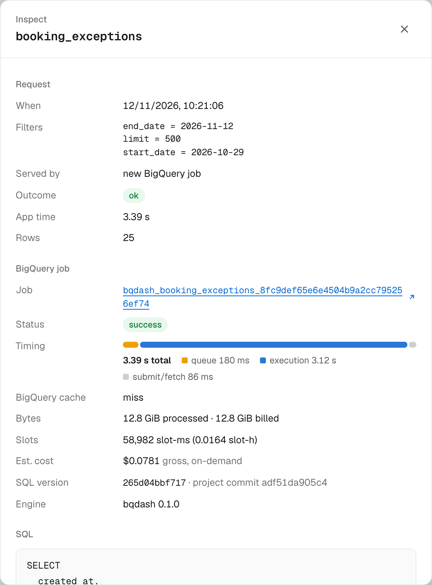
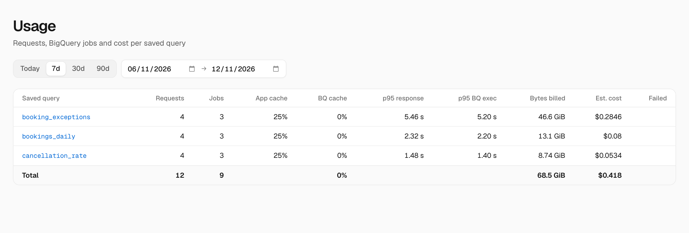

<div align="center">

# Axial

**SQL dashboards as code. You can see what every tile costs.**

Write SQL and a few lines of YAML, commit them to Git, and run the dashboard locally with one
command. Use BigQuery or a local DuckDB file. On BigQuery, every tile links to the job that
ran it, with its timing, bytes billed and SQL version.

[](https://www.python.org/downloads/)
[](https://cloud.google.com/bigquery)
[](#built-for-coding-agents)

</div>

```sh
axial init my-ops && cd my-ops && axial up --fixture
```

<picture>
  <source media="(prefers-color-scheme: dark)" srcset="docs/dashboard-dark.png">
  
</picture>

*Illustrative data from the test project, shown in live mode against a simulated warehouse.
The amber dot marks a tile that took over 3 seconds to load.*

## What you get

- **Dashboards in Git:** each dashboard is one YAML file. Each query is a `.sql` file plus a
  `.yaml` file that declares its typed params and output columns. Review changes in pull
  requests, like any other code.
- **One command to launch:** `axial up` checks the project, your credentials and the engine
  version, then serves the dashboard on 127.0.0.1 and opens the browser.
- **Calm and dense by default:**
  - Geist type, hairline cards, and light, dark or system themes.
  - Sticky table headers, right-aligned numbers, and explicit money, percent and duration
    formats.
  - You choose what goes on the page; Axial decides how it looks.
- **Cost on every tile:** hover a tile and click **Inspect** to open the BigQuery job behind
  it: queue and execution time, bytes billed, slots, cache hit, the exact SQL version and
  a console link.
- **One job per query:** tiles that share a query share one job, and identical concurrent
  requests share one in-flight job. A warm reload submits nothing.
- **Guard rails:** typed and validated params, a single read-only `SELECT` per query,
  `maximum_bytes_billed` on every job, a row cap and a concurrency limit.
- **Before/after measurements:** `axial bench` runs a query with both caches bypassed, and
  the usage screen compares SQL versions on the same dates.
- **Share as a PDF:** **Export PDF** in the toolbar (or Cmd/Ctrl+P) prints the dashboard as
  it is on screen: light theme, A4 landscape, vector charts, every loaded table row, and a
  line saying when it was generated and from what data. `axial preview --pdf` does the same
  from the command line.
- **Ready for coding agents:** every project ships with rules, three skills for Codex and
  Claude Code, and free discovery commands with JSON output.

Axial supports BigQuery and local DuckDB files, and runs as a single process. It runs
locally by default; `axial serve` and the project's `Dockerfile` run it as a container, for
example on Cloud Run behind Identity-Aware Proxy (see [Deploy to Cloud Run](#deploy-to-cloud-run)).
There is no managed hosted mode.

## Quickstart

### 1. Install the prerequisites

For BigQuery, you need the [gcloud CLI](https://cloud.google.com/sdk/docs/install) and a
Google Cloud project with BigQuery enabled to bill queries to. On macOS with Homebrew:

```sh
brew install --cask google-cloud-sdk
```

### 2. Install Axial

With Homebrew on macOS or Linux:

```sh
brew tap lucasscariot/axial https://github.com/lucasscariot/axial
brew install lucasscariot/axial/axial
axial --version
```

This repository also serves as the Homebrew tap; the explicit URL is needed when first
adding it. Homebrew installs Axial, Python and DuckDB support, with dependencies pinned by the
source lockfile. The first package uses the immutable rename commit; subsequent versions
follow tagged Axial releases.

Alternatively, with [uv](https://docs.astral.sh/uv/getting-started/installation/):

```sh
uv tool install 'git+https://github.com/lucasscariot/axial.git@main'
uv tool update-shell
axial --version
```

The built UI ships inside the package, so you don't need Node or a GitHub account.

### 3. Create a project and look at it

```sh
axial init my-ops --billing-project my-gcp-project --location EU
cd my-ops
axial up --fixture
```

`--fixture` renders the example dashboard with representative data, with no BigQuery
account involved. Edit `dashboards/overview.yaml` and reload the page to see the change.

### 4. Connect BigQuery

```sh
gcloud auth application-default login
axial dry-run orders_daily      # free: bytes estimate, tables read
axial up
```

First point `queries/orders_daily.sql` at one of your tables. Queries run with your
Application Default Credentials, so your BigQuery permissions decide what dashboards can read.

## A dashboard in two files

```yaml
# queries/bookings_daily.yaml
title: Daily bookings
params: {start_date: DATE, end_date: DATE}
columns: {day: DATE, bookings: INT64, gross_value: NUMERIC}
formats: {gross_value: money}
labels: {gross_value: Gross value (GBP)}     # optional display names
```

```sql
-- queries/bookings_daily.sql   (end_date is exclusive)
SELECT DATE(created_at) AS day, COUNT(*) AS bookings, SUM(gross_value) AS gross_value
FROM `analytics.fct_bookings`
WHERE DATE(created_at) >= @start_date AND DATE(created_at) < @end_date
GROUP BY day ORDER BY day
```

```yaml
# dashboards/booking_ops.yaml
title: Booking operations
date_range: {default_days: 7, max_days: 31}
tiles:
  - {type: kpi,   query: bookings_daily, value: bookings, reduce: sum, span: 3}
  - {type: line,  query: bookings_daily, x: day, y: bookings, span: 9}
  - {type: table, query: booking_exceptions, span: 12}
```

The KPI and the trend share one BigQuery job. Tile types are `kpi`, `line`, `bar`, `funnel`,
`table` and markdown `text`. `axial guide dashboards` has the full reference.

## Everyday use

| Want to… | Run |
| --- | --- |
| Launch the project | `axial up` |
| Launch without BigQuery | `axial up --fixture` |
| Serve in a container (`0.0.0.0`, `$PORT`, no browser) | `axial serve` |
| Validate queries and dashboards | `axial check` |
| See what a query would scan (free) | `axial dry-run <query>` |
| Find tables and columns (free) | `axial tables`, `axial schema <table>` |
| See what each query costs (free) | `axial usage`, or **Query usage** in the app |
| Print a query's rows (billed) | `axial run <query> --start 2026-11-01 --end 2026-11-08` |
| Measure a change, caches bypassed (billed) | `axial bench <query> --start … --end …` |
| Screenshot a dashboard | `axial preview <dashboard> --fixture --screenshot out.png` |
| Save a dashboard as a PDF to share | **Export PDF** in the app, or `axial preview <dashboard> --pdf out.pdf` |
| Read the reference for your version | `axial guide [queries\|dashboards\|config\|cli\|deploy\|migration]` |
| Refresh agent files after an upgrade | `axial agents sync` |

`--start` is inclusive and `--end` is exclusive. Most commands accept `--json`.

## Know what every tile costs

<table>
<tr>
<td width="45%"></td>
<td>

**Inspect** (hover any tile) opens the run behind it:
- the filters used, and whether the result came from a new job, a shared job or the app cache
- the BigQuery job, with a console link
- a queue, execution and transfer timing bar
- bytes processed and billed, slots, the BigQuery cache result and the estimated cost
- the SQL hash and project commit, so you can tell exactly which SQL produced the numbers

**Query usage** groups history by saved query:
- requests vs. jobs, and app and BigQuery cache hit rates
- p95 response and p95 BigQuery execution time
- bytes billed with an estimated on-demand cost, or slot-hours on reservations

Each query drills down to its individual runs and to a **SQL versions** table that compares
median execution time, bytes billed and slot-ms between versions.

</td>
</tr>
</table>



### How a dataset is served

1. **Validate.** The browser sends a query ID and filter values. The server checks that the
   query is on that dashboard, validates types and the date range, and binds native
   BigQuery parameters.
2. **Reuse.** The cache key is query ID + SQL hash + normalized params (default TTL 120 s).
   Concurrent requests for the same key share one in-flight job.
3. **Limit.** At most 4 jobs run at once, results are capped at 2,000 rows, and every job
   carries `maximum_bytes_billed`.
4. **Trace.**
   - Each job's ID is generated by Axial and saved before submission.
   - If a submit times out, Axial looks up that same ID before retrying.
   - If the dashboard stops waiting, a background reconciler still records the final job stats.

History lives in `.axial/history.sqlite3`, or in PostgreSQL for hosted instances that
share it (`storage.backend: postgres`). App cache hits reuse the original job, so spend is
never counted twice.

## Built for coding agents

Every project `axial init` creates includes:

| File | For |
| --- | --- |
| `AGENTS.md` | Rules: which commands are free and which are billed, SQL conventions, what "done" means. Codex reads it. |
| `CLAUDE.md` | Imports `AGENTS.md` for Claude Code. |
| `.agents/skills/`, `.claude/skills/` | `build-dashboard`, `optimize-query` and `rebuild-dashboard`, for Codex and Claude Code. |
| `CONTEXT.md` | **Yours:** trusted tables, metric definitions, conventions. Agents read it first. |

```text
> build a dashboard of cancellations by region for the last 30 days
```

`build-dashboard` takes the agent through these steps:
1. Find tables (`axial tables`, `axial schema`).
2. Write the SQL and YAML.
3. Check the cost (`axial dry-run`) and validate (`axial check`).
4. Look at a rendered screenshot before calling it done.

`optimize-query` finds your costliest query and proves the improvement with `axial bench`.
`rebuild-dashboard` recreates a Metabase dashboard and produces a per-metric table to check
its numbers against the original.

Skills stay short and read `axial guide` for reference, so the instructions always match the
installed engine. Generated files carry an `axial:managed` marker, and `axial agents sync`
refreshes them after an upgrade. `axial up` tells you when they're stale.

## Deploy to Cloud Run

Every project `axial init` creates has a `Dockerfile` and `.dockerignore`. The image
installs the project's axial release, copies the project (without `.axial/` history, local
DuckDB files or credentials), runs as a non-root user and starts `axial serve`.

```sh
docker build --build-arg APP_REVISION=$(git rev-parse --short=12 HEAD) -t my-dashboards .
gcloud run deploy my-dashboards --image … --service-account … \
  --no-allow-unauthenticated --max-instances=1
```

**Never deploy it publicly.** Axial has no login. Anyone who can reach it can run billed
queries as the service account, so put it behind Identity-Aware Proxy or Cloud Run IAM.
Every viewer reads data with the service account's permissions. History is kept on the
container's in-memory filesystem and is lost when the instance stops. `GET /api/health` is
a probe endpoint. `axial guide deploy` covers roles, IAP, configuration and limitations.

## Migrating from bqdash

Run `axial guide migration` for the full steps. Rename `bqdash.yaml` to `axial.yaml`,
set `version: 2`, move `.bqdash/` to `.axial/` and update `storage.path`, `.gitignore`,
environment overrides (`BQDASH_` → `AXIAL_`) and scripts. Stop the old process before
moving history. Its SQLite format is unchanged. `axial agents sync` recognizes old
managed markers and updates generated agent files without overwriting handwritten notes.

## Configuration

`axial.yaml` is committed with the project, since none of its values are secrets. Override
any value with an environment variable named `AXIAL_<SECTION>_<KEY>`:

```sh
AXIAL_BIGQUERY_BILLING_PROJECT=other-project AXIAL_SERVER_PORT=9000 axial up
```

| Section | Keys |
| --- | --- |
| `warehouse` | `bigquery` (default) or `duckdb` |
| `bigquery` | `billing_project`, `location`, `datasets`, `maximum_bytes_billed`, `wait_timeout_seconds` |
| `duckdb` | `path`, `datasets`, `allow_external_access`, `threads`, `memory_limit` |
| `billing` | `mode` (`on_demand` \| `reservation`), `price_per_tib_usd` |
| `execution` | `default_cache_ttl_seconds`, `max_concurrent_jobs`, `row_cap` |
| `display` | `title`, `locale`, `currency`, `brand_color`, `logo`, `slow_tile_ms` |
| `server` | `port` (`axial up` uses the next free port if it's taken; `axial serve` prefers `$PORT`) |
| `storage` | `backend` (`sqlite` \| `postgres`), `path` (SQLite), `url` and `pool_size` (PostgreSQL) |

To chart a local DuckDB file instead of BigQuery, create the project with
`axial init my-dash --duckdb ../data/analytics.duckdb` (or set `warehouse: duckdb` and
`duckdb.path`). Queries keep `@params`, the file is opened read-only, and the cost columns
disappear because nothing is billed. The Homebrew installation includes DuckDB. With uv,
install with the extra: `uv tool install
'axial[duckdb] @ git+https://github.com/lucasscariot/axial.git@main'`.

To keep history across restarts on a host with an ephemeral disk (Cloud Run, for example),
install `axial[postgres]`, set `storage.backend: postgres` and pass the connection string in
`AXIAL_STORAGE_URL`, so no password is committed. `axial guide config` has a Cloud SQL
example. The app cache stays per instance.

Behind Identity-Aware Proxy, `server.trust_iap_user: true` records which signed-in user made
each request, shown in Inspect and Query usage. Turn it on only when IAP is the only way to
reach the service: it trusts IAP's identity header without verifying its signature, and it
stores viewers' emails in history. `axial guide config` explains the trade-offs.

`engine: ">=0.1,<0.2"` pins the axial versions a project works with. `axial guide config`
documents every key.

## Troubleshooting

| Problem | What to try |
| --- | --- |
| `axial` is not found | For Homebrew, follow `brew shellenv` setup instructions; for uv, run `uv tool update-shell`, then open a new terminal |
| `bigquery.billing_project is not set` | Set it in `axial.yaml`, set `AXIAL_BIGQUERY_BILLING_PROJECT`, or use `--fixture` |
| `no Google credentials found` | Run `gcloud auth application-default login` |
| `this project needs axial …` | Install a version inside the project's `engine:` range |
| A tile says the job exceeded the bytes limit | `axial dry-run <query>`; filter on the partition column, or raise `maximum_bytes_billed` deliberately |
| A tile shows **Truncated** | The result passed the row cap; aggregate more in SQL or add `LIMIT @limit` |
| A tile timed out | The job keeps running; its stats are reconciled later. Check **Query usage** or run `axial reconcile` |
| `agent files differ from this engine version` | Run `axial agents sync` |
| `refusing to overwrite` on `init` | Use an empty or new directory |
| `screenshots and PDFs need playwright` | Use the uv installation with `uv tool install --force --with-executables-from playwright 'axial[screenshot] @ git+https://github.com/lucasscariot/axial.git@main'`, then `playwright install chromium`. The in-app **Export PDF** button needs neither |
| Wrong location errors from BigQuery | Set `bigquery.location` to where the data lives (e.g. `EU`, `US`, `europe-west2`) |

## Update or uninstall

For Homebrew:

```sh
brew update && brew upgrade lucasscariot/axial/axial
brew uninstall axial
```

For uv:

```sh
uv tool upgrade axial          # then, in each project: axial agents sync
uv tool uninstall axial
```

Uninstalling leaves your projects and their `.axial/` history untouched.

## Development

```sh
git clone git@github.com:lucasscariot/axial.git && cd axial
make install    # uv sync --all-extras + npm ci
make test       # pytest + TypeScript type-check
make web        # rebuild the UI into src/axial/web_dist (commit the result)
make preview    # render tests/project with fixture data
```

The tests run against `tests/project/` and a fake warehouse, so they need no Google account.
CI also builds the wheel, creates a project from it, and rejects a stale committed UI build.

**Releasing:**

[Google's release-please](https://github.com/googleapis/release-please) maintains a release
PR as Conventional Commits land on `main`. It updates `pyproject.toml`, the axial version
in `uv.lock`, `CHANGELOG.md` and `.release-please-manifest.json` together.

1. Use Conventional Commit PR titles; squash merging preserves them on `main`. While the
   engine is 0.x, `fix:` and compatible `feat:` changes bump the patch version. Mark breaking
   changes with `!` and a `BREAKING CHANGE:` footer to bump the minor version. From 1.0,
   features bump minor and breaking changes bump major.
2. Review the release PR and add **Upgrade notes** to its `CHANGELOG.md` entry when projects
   must change. Wait for CI, then merge the release PR when ready to ship.
3. Release-please creates the `vX.Y.Z` tag and GitHub release. CI also runs against the tag
   and checks that it matches the package version. Install a release with, for example,
   `uv tool install --force 'git+https://github.com/lucasscariot/axial.git@v0.2.0'`
   once that Axial release is published. Older tags through `v0.1.2` install bqdash.
4. The release workflow dispatches `homebrew-update.yml`, which opens a separate PR pinning
   `Formula/axial.rb` to the release archive and its SHA-256. Review its Homebrew install
   tests on macOS and Linux, then merge it to make the release available to `brew upgrade`.
   No additional token or tap repository is needed.

The initial Axial 0.1.2 source snapshot is retained under the `axial-bootstrap-0.1.2`
tag, so the first formula remains downloadable after the rename branch is deleted.
Subsequent version tags are managed by release-please.

To retry a Homebrew update, run the **update homebrew** workflow on `main` with the published
tag. To update the formula locally, run `uv run python scripts/update_homebrew.py vX.Y.Z` and open
a PR. The formula uses `uv sync --frozen` at build time to install the release's locked
dependencies into a private environment; it does not require uv at runtime. Browser
automation for command-line screenshots and PDFs remains available through the uv install.

The existing `0.1.0` is the development baseline, with history through `817e52c` already
covered by its changelog notes. The rename is a breaking change and proposes `0.2.0`. Ordinary
`chore:` and `ci:` commits do not trigger a release by themselves.

The workflow uses the built-in `GITHUB_TOKEN`; no extra secret is needed. Repository
Settings → Actions → General must allow GitHub Actions to create and approve pull requests.
Because bot-created refs do not start ordinary workflows automatically, release-please
explicitly dispatches CI on its release branches and tags. The release-please workflow also
supports **Run workflow** on `main` to retry a failed run. Version bumps and tags are managed
by release-please; maintainers decide when to release by merging its PR.

## Credits

Built with [FastAPI](https://fastapi.tiangolo.com/), [React](https://react.dev/),
[Apache ECharts](https://echarts.apache.org/),
[google-cloud-bigquery](https://github.com/googleapis/python-bigquery),
[Click](https://click.palletsprojects.com/) and [uv](https://docs.astral.sh/uv/).
